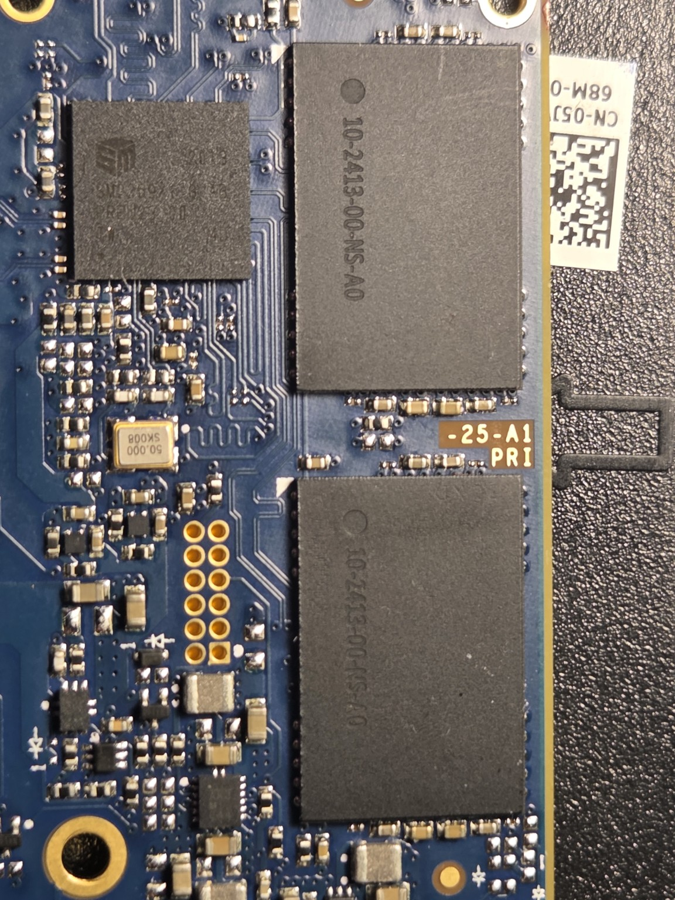
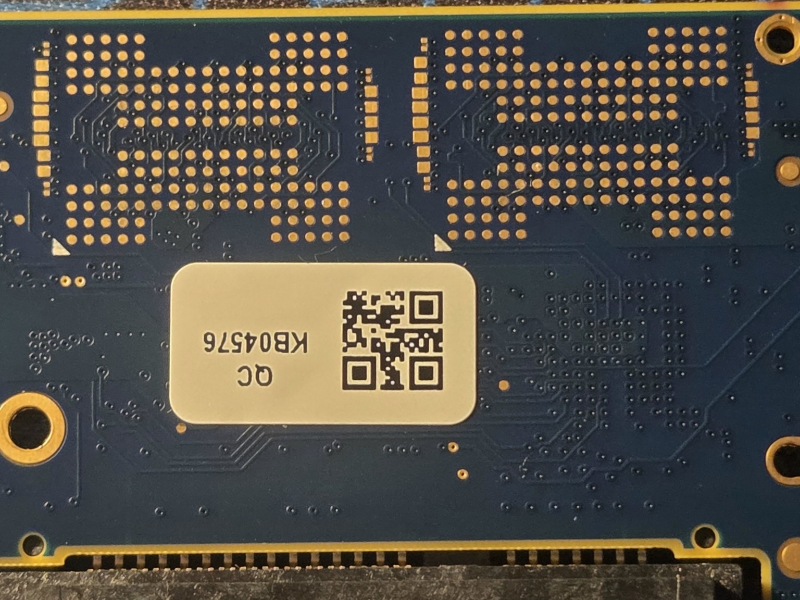
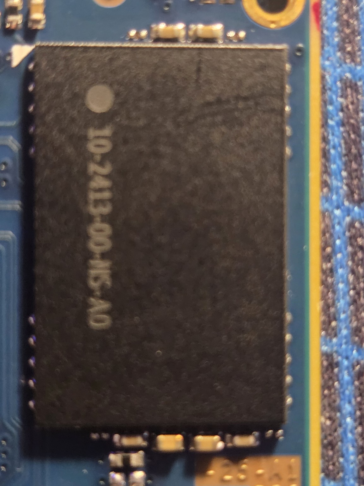
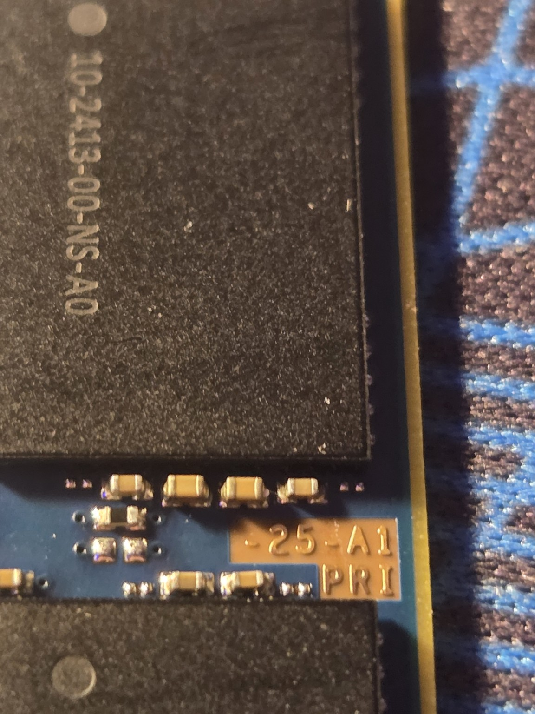

# FrankenSSD 💾⚡

**An experimental NAND transplant project by Robot Snow Shoes Labs**  
*Questionable Methods. Remarkable Results.*

> **Project status:** Firmware capacity-change experiment succeeded. Full capacity write/verify test was running at last report. NAND transplant and 1 TB operation are **not yet demonstrated**.

## The idea

Can we turn a **500 GB Axiom C565n SATA SSD** into a **1 TB SSD** by harvesting two matching NAND packages from another drive, installing them onto the two unused BGA footprints, and reinitializing the controller using Silicon Motion manufacturing tools?

This is a hobby electronics experiment, **not** a proven upgrade guide or a recommended method for storing important data. Donor and recipient SSDs are sacrificial.

## Hardware

| Item | Observed details |
| --- | --- |
| SSD | Axiom C565n, marketed as 500 GB SATA |
| Controller | Silicon Motion **SM2259XT** |
| Firmware | **S1120A0** |
| NAND | Micron **N28A**, 96-layer QLC (identified by MPTool) |
| Flash ID | `2C D3 1C 32 C6 00 00 00` |
| Flash arrangement | Two populated NAND packages; two additional empty footprints |
| MPTool-reported flash | `Micron,1Tbit,MT29F1T08GBLBE(N28A)(SM2259XT)` |
| Package marking | `10-2413-00-NS-A0` (physical BGA pitch/pinout not yet verified) |
| MPTool package | `SM2259XT_N28A_PKGS1129A_FWS1120A0_HT20200222` |
| Working setup | Native Windows 11, SSD connected to native SATA |

## Experiment log

| Phase | Status | Result |
| --- | --- | --- |
| Identify controller and NAND | ✅ Complete | SM2259XT, Micron N28A, firmware S1120A0 |
| Connect MPTool | ✅ Complete | Native SATA worked; ASMedia ASM1166 PCI SATA pass-through did not detect SSD in MPTool |
| Reprogram reported capacity | ✅ Complete | Manual LBA `488281250` (250,000,000,000 bytes) |
| Reboot and confirm new geometry | ✅ Complete | Windows Disk Management reported ~232.83 GiB |
| Initialize and format | ✅ Complete | `FrankenSSD (F:)`, NTFS, ~232.81 GiB formatted |
| Full write/verify (H2testw) | ⏳ Awaiting result | Test started; result not yet recorded |
| Restore original 500 GB configuration | ⬜ Planned | Not yet tested |
| Identify supporting components | 🔎 Investigating | Some SMD footprints beside unused NAND locations are unpopulated |
| Harvest and reball donor NAND | ⬜ Planned | Not yet performed |
| Transplant NAND and required passives | ⬜ Planned | Not yet performed |
| Detect expanded flash and verify 1 TB | ⬜ Goal | Not yet demonstrated |

**Why 232.83?** Windows displays binary units (GiB) while often labeling them “GB.” `488281250 × 512` bytes is exactly 250 GB decimal, approximately 232.83 GiB.

## Evidence gallery

| Populated side | Empty NAND footprints |
| --- | --- |
|  |  |

The white triangle markings are useful orientation references, but **pin-1 alignment and package footprint must be verified** before installation.

## The passive-component question

The populated NAND side has small ceramic-looking SMD components near the packages. Corresponding areas around the unpopulated NAND sites contain bare pads. **We have not established which parts are mandatory**, or whether all empty pads are intended to be populated.

Plan: photograph the donor board, inventory **only actual unpopulated component footprints adjacent to the unused NAND sites**, measure selected donor components out of circuit, and compare power/signal connections as needed. Do **not** populate every empty pad on sight.

See [Component investigation worksheet](docs/component-inventory.md).

## Planned tools

- Existing generic **858D** hot-air rework station (adjustable temperature and airflow)
- Quality tacky flux, solder wick, magnification, ESD-safe handling
- PCB preheater and thermocouple for controlled heating
- Matching BGA stencil and appropriate solder balls **after package geometry is confirmed**
- Multimeter; optional LCR meter for component measurement

**Note:** Low-melt removal alloy is not preferred on NAND packages intended for reuse. Reballing, board preheat, and temperature control will be important.

## Open questions

1. Will the controller firmware enumerate two additional NAND packages, and which channel/CE configuration is required?
2. Are both empty BGA sites fully routed and powered?
3. Which neighboring passive components are actually required?
4. What are the correct BGA pitch, ball diameter, and reball stencil?
5. Will the expanded drive survive a complete write/read verification, including power cycles?

## Safety and data integrity

**Experimental hardware only.** Manufacturing tools can erase all data and render SSDs unusable. Verify the target disk before using destructive tools. Do not put important data on an experimental drive. Work with ventilation, controlled heat, and power disconnected during soldering or resistance measurements. A reported capacity alone does **not** prove the physical flash is present or usable.

## Project updates

Follow along as we turn the experiment into a reproducible lab notebook. Results, failures, and the occasional escaped 0402 capacitor all belong here.

---

**Robot Snow Shoes Labs**  
*Questionable Methods. Remarkable Results.*
